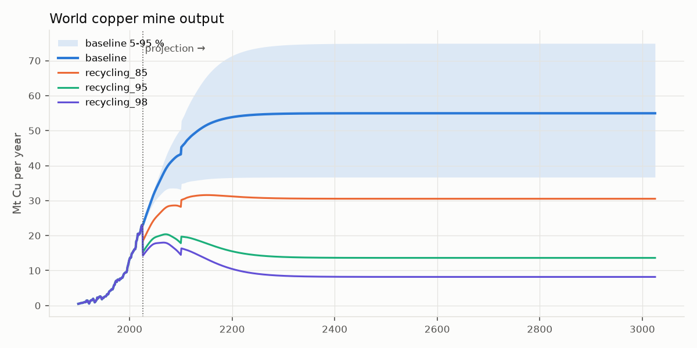
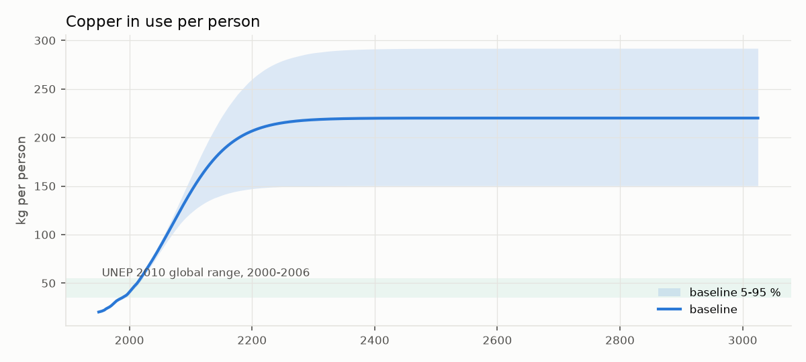
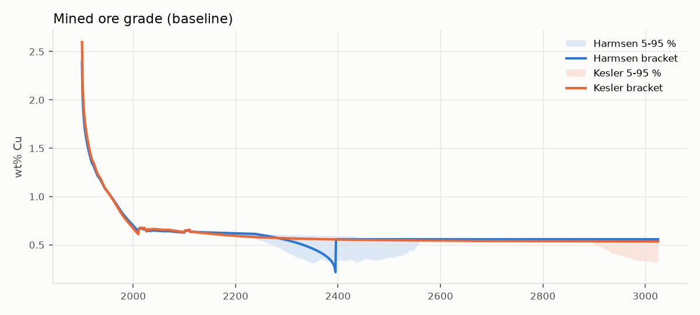
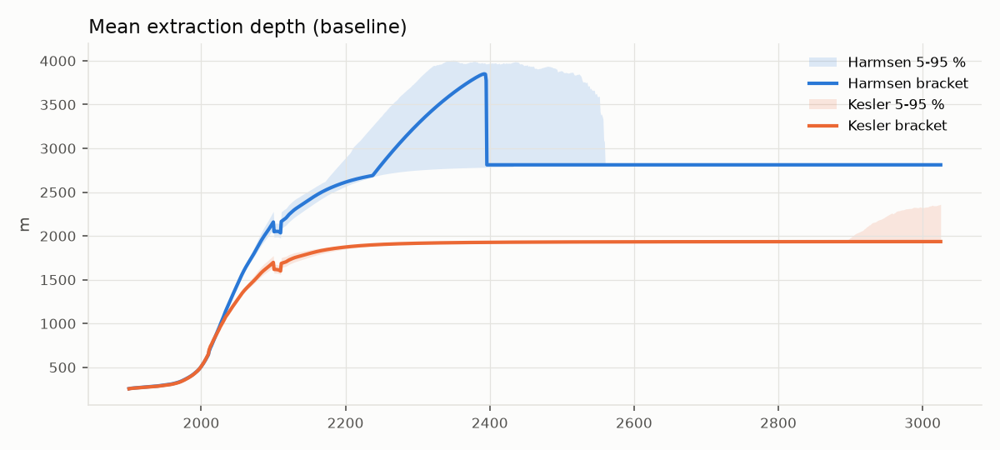
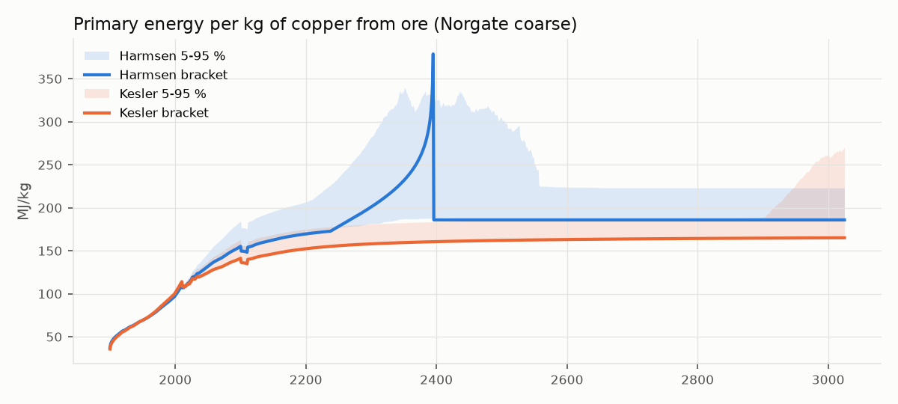
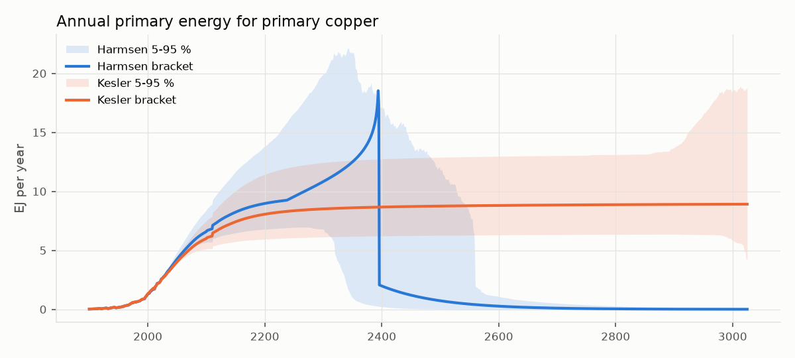
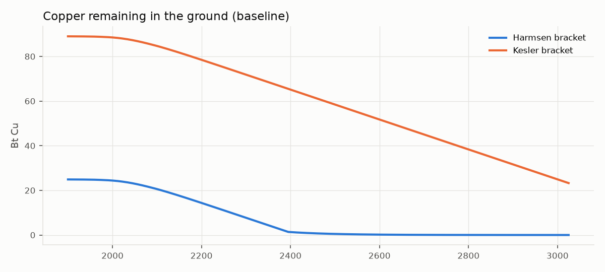

# Phase 1 validation report — copper core

*Generated by `metalwheels report phase1` (metalwheels 0.1.0, commit `99c45f3+dirty`). Do not edit by hand; regenerate instead.*

**Result: 25 of 26 checks pass.** 1 failing cross-check explained and accepted (see *Deviations*).

## Calibration and validation checks

| Task | Check | Model | Target | Result | Source / note |
|---|---|---|---|---|---|
| 1.1 | annual rows 1900-2025, no gaps | 126.0 | 126 | PASS |  |
| 1.1 | cumulative mine output 1900-2015 | 647.9 Mt | 600 +/- 10 % | PASS | USGS past production ~600 Mt (MCS 2026) |
| 1.1 | mine output 2025 | 23.0 Mt | 23 +/- 0.5 | PASS | MCS 2026 estimate |
| 1.2 | in-use stock 2010 | 338.2 Mt | 320-380 | PASS | Glöser-Chahoud Fig. 5.12 |
| 1.2 | EoL outflow 2011 | 11.5 Mt | 11.1 +/- 1.5 | PASS | Glöser-Chahoud Fig. 5.8 |
| 1.2 | max stock mass-balance residual | 4.41e-15 | < 1e-6 | PASS |  |
| 1.3 | 2011 tailings | 3.534 Mt | 3.55 +/- 15 % | PASS | Helbig 2020 Fig. S11 |
| 1.3 | 2011 old scrap | 5.336 Mt | 5.2 +/- 15 % | PASS | Helbig 2020 Fig. S11 |
| 1.3 | 2011 other scrap markets | 2.397 Mt | 2.3 +/- 15 % | PASS | Helbig 2020 Fig. S11 |
| 1.3 | 2011 not recycled | 3.809 Mt | 3.6 +/- 15 % | PASS | Helbig 2020 Fig. S11 |
| 1.3 | 2011 dissipation | 0.448 Mt | 0.45 +/- 15 % | PASS | Helbig 2020 Fig. S11 |
| 1.3 | cumulative landfill 2010 | 112.0 Mt | 105-170 | PASS |  |
| 1.3 | max ore-to-media balance residual | 4.69e-15 | < 0.1 % | PASS |  |
| 1.4 | refined demand 2026 | 28.2 Mt | 26-32 | PASS |  |
| 1.4 | stock vs saturation target at horizon | -1.83e-07 % | within 1 % | PASS |  |
| 1.4 | max per-capita stock | 220.0 kg/person | <= 220 | PASS |  |
| 1.5 | median grade (Gerst global porphyry) | 0.516 wt% | 0.52 +/- 0.01 | PASS |  |
| 1.5 | mined grade 2010 (harmsen) | 0.640 wt% | 0.50-0.75 (obs. 0.62) | PASS | Northey 2014: ~0.62 % |
| 1.5 | mined grade 2010 (kesler) | 0.611 wt% | 0.50-0.75 (obs. 0.62) | PASS | Northey 2014: ~0.62 % |
| 1.6 | norgate_coarse reproduces source points | 1.11e-14 % max dev | within 2 % | PASS |  |
| 1.6 | koppelaar_surface reproduces source points | 0.396 % max dev | within 3 % | PASS |  |
| 1.7 | 23 Mt Cu at 0.62 % -> ore | 3.710 Gt | 3.7 +/- 0.05 | PASS |  |
| x | EoL recycling rate 2011 | 0.462 | 0.46 +/- 0.05 | PASS | Glöser-Chahoud Tab. 5.3 |
| x | global per-capita stock 2000-2006 (range) | 45.3 kg/person | 35-55 | PASS | min 40.8; UNEP 2010 Table 1 |
| x | refined copper vs ICSG 1960-2019 (max annual abs dev) | 14.3 % | within 10 % | **FAIL** | worst 1966 (-14.3 %), of which USGS vs ICSG *mine* data differ -8.2 %; ICSG Factbook 2020 p. 59 |
| x | refined copper vs ICSG, decadal means (max abs) | 8.827 % | within 10 % (added after the annual check failed) | PASS | decades 1960s -8.8, 1970s -4.8, 1980s -2.5, 1990s +3.4, 2000s +6.1, 2010s +2.2 |

### Deviations

- **refined copper vs ICSG 1960-2019 (max annual abs dev)** (14.3 % vs within 10 %). Independent cross-check (not a PLAN target). The worst single year is driven mostly by USGS and ICSG disagreeing on world *mine* production that year. The remaining pattern - model low in the 1960s (about -9 %), high in the 2000s (about +6 %) - is what constant collection/processing rates over 1900-2025 produce if real recycling was higher than 0.67 x 0.69 in the 1960s and lower during the 2000s China boom. Decadal means stay within 10 %. **Status: accepted by Steve, 2026-10-15** (time-varying historical recycling rates left as a possible refinement).

## Baseline results (both endowment brackets, side by side)

| Quantity | Unit | Harmsen 2013 | Kesler & Wilkinson 2008 |
|---|---|---|---|
| Endowment | Mt Cu | 24,890 (24,890–24,890) | 89,000 (89,000–89,000) |
| First supply shortfall | year | 2,395 (2,319–2,559) | - (shortfall in 5% of draws, 2,908–3,025) |
| Mined grade 2050 | wt% | 0.646 (0.635–0.651) | 0.661 (0.649–0.667) |
| Mined grade 2100 | wt% | 0.628 (0.612–0.638) | 0.631 (0.610–0.644) |
| Mean depth 2050 | m | 1,443 (1,435–1,460) | 1,269 (1,258–1,291) |
| Mean depth 2100 | m | 2,159 (2,078–2,280) | 1,698 (1,644–1,775) |
| Energy intensity 2050 | MJ/kg | 131.8 (132.5–147.5) | 124.7 (125.2–137.8) |
| Energy intensity 2100 | MJ/kg | 155.1 (155.7–184.8) | 141.3 (141.3–163.2) |
| Primary energy 2100 | EJ/yr | 6.586 (5.681–8.395) | 5.998 (5.102–7.471) |
| Cumulative primary energy to horizon | EJ | 3,654 (3,687–4,358) | 8,366 (6,129–12,346) |
| Cumulative tailings volume at horizon | km³ | 3,134 (2,982–3,352) | 8,236 (5,717–11,579) |

Brackets in parentheses are Monte Carlo 5–95 % ranges (scenario=baseline, seed=20261015, draws=1000, workers=1). The central value is the sourced baseline, which need not sit at the Monte Carlo median: for example the depth-energy term uses Harmsen's 2.9 MJ/kg per 100 m, the low end of the sampled 2.9–4.6 range, so baseline energy intensity sits at or just below the 5 % band.

## Recycling scenarios (policy from 2026)

| Scenario | Mine output 2026–3025 (Bt Cu) | Mine output 2100 (Mt/yr) | Harmsen first shortfall | Primary energy 2100, Harmsen (EJ/yr) | Cumulative primary energy, Kesler (EJ) |
|---|---|---|---|---|---|
| baseline | 53.0 | 43.2 | 2395 | 6.586 | 8,366 |
| recycling_85 | 30.3 | 28.2 | 2653 | 4.463 | 4,824 |
| recycling_95 | 14.5 | 17.8 | - | 3.006 | 2,374 |
| recycling_98 | 9.461 | 14.5 | - | 2.543 | 1,586 |

## Framing against the literature

- **Northey et al. 2014** (GeRS-DeMo): supply-constrained scenarios built on *identified* resources peak at 25–27.5 Mt in 2029–2033 and fall to ~0.1–3 Mt by 2100; their unconstrained 'static demand' reaches 43.5 Mt (2050) and 99.1 Mt (2100). This model is demand-driven with paced discovery, so it has no near-term peak: baseline mine output is 32.8 Mt in 2050 and 43.2 Mt in 2100, between Northey's two framings because recycling supplies a growing share of demand.
- **Harmsen et al. 2013** frame scarcity as rising energy along a depth-layered supply curve. Here grade stabilises near 0.55–0.65 % once paced discovery opens the undiscovered pool, and **depth becomes the main escalator**. At today's recycling rates, demand on the Harmsen endowment (24.9 Bt to 5 km) first outruns discovery in 2,395; from then on supply is limited to each year's (diminishing) new discoveries.
- **Kesler & Wilkinson 2008**: 89 Bt above 3.3 km is not exhausted by 3025 in any scenario, but extraction settles near ~1.9 km depth.

## Known simplifications (carried into Phase 2)

1. Collection and processing rates and end-use shares are constant over 1900–2025 (2002–2012 means).
2. Zero in-use stock in 1900 (pre-1900 copper ignored); likely why 2010 landfill sits near the low end.
3. Tailings share 18 % in all years (early-century concentrator losses were probably higher).
4. ICA 'Equipment' mapped to Glöser-Chahoud's consumer & electronics group; equal split within categories.
5. Saturation = midpoint of today's more-developed-country per-capita stock (140–300 kg).
6. Discovery is uniform across depth, follows a 10-year demand trend and is capped at 1 %/yr of what remains undiscovered (both assumptions); the depth-order multiplier is calibrated, not physical.
7. Energy covers primary copper only; secondary (scrap) energy still needs a source.
8. When an endowment is exhausted, demand is still assumed met by the stock-flow model (shortfall reported; no feedback in Phase 1).
9. Koppelaar's fit covers mining + concentrating only; Norgate is cradle-to-cathode.

## Figures

