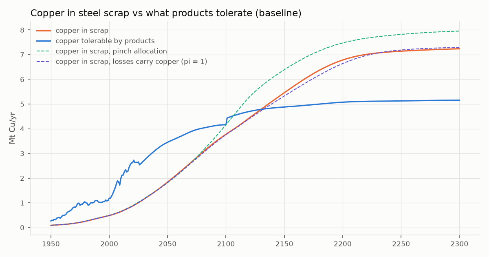
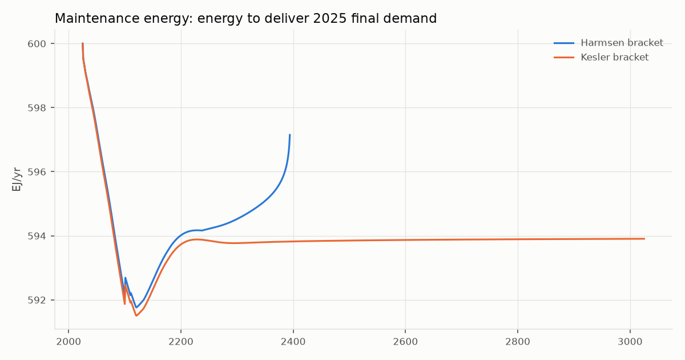
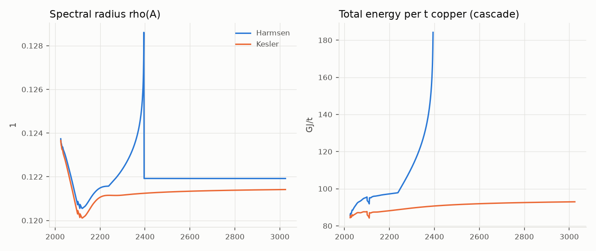

# Phases 2-3 report — steel coupling and cascade

*Generated by `metalwheels report phase23` (metalwheels 0.1.0, commit `98ee42f+dirty`). Do not edit by hand; regenerate instead.*

**Result: 15 of 15 checks pass.**

## Done conditions and validation

| Task | Check | Model | Target | Result | Source / note |
|---|---|---|---|---|---|
| 2.1 | 2008 scrap Cu, transport | 0.300 wt% | 0.2-0.5 wt% | PASS | Daehn 2017 SI Table S21 range |
| 2.1 | 2008 scrap Cu, industrial equipment | 0.200 wt% | 0.2-0.4 wt% | PASS | Daehn 2017 SI Table S21 range |
| 2.1 | 2008 scrap Cu, construction | 0.100 wt% | 0-0.1 wt% | PASS | Daehn 2017 SI Table S21 range |
| 2.1 | 2008 scrap Cu, metal goods | 0.300 wt% | 0.2-0.4 wt% | PASS | Daehn 2017 SI Table S21 range |
| 2.2 | copper -> steel conservation (max rel. residual) | 5.52e-16 | < 1e-6 | PASS | every year 1900-3025 |
| 2.3 | dilution share 0.4 -> 0.1 wt% (c_p 0.02) | 0.789 | 0.79 | PASS |  |
| 2.3 | crossover with Daehn-equivalent inputs | 2049 | 2040-2060 | PASS | Daehn Fig. 3 snapshots |
| 2.3 | copper tolerable 2008 | 1.858 Mt | 1.8 Mt +/- 15 % | PASS | Daehn 2017 p. 6602 |
| 2.1 | steel stock per capita 2008 | 3.269 t | 3.7 t +/- 15 % | PASS | Pauliuk 2013a p. 3451 |
| 2.1 | steel stock per capita 2100 | 9.615 t | ca. 10 t +/- 15 % | PASS | Pauliuk 2013a p. 3451 |
| 2.1 | end-of-life scrap 2008 | 256.3 Mt | 298 Mt +/- 20 % | PASS | Daehn 2017 SI Table S22 |
| 3.3 | maintenance energy 2025 reproduces supply (harmsen) | 600.0 EJ/yr | 600 EJ | PASS | y = (I - A_2025) x_2025 |
| 3.2 | rho(A) below warning level (harmsen) | 0.129 | < 0.9 | PASS |  |
| 3.3 | maintenance energy 2025 reproduces supply (kesler) | 600.0 EJ/yr | 600 EJ | PASS | y = (I - A_2025) x_2025 |
| 3.2 | rho(A) below warning level (kesler) | 0.124 | < 0.9 | PASS |  |

## Steel coupling (Phase 2)

Copper reaches steel scrap through the copper module's *other scrap markets* flow. Shares of it per steel sector are calibrated each run so 2008 scrap copper matches Daehn et al. (2017): transport 0.69, industrial equipment 0.29, construction 0.02, metal goods 0.14. Copper put into steel stays with each cohort and comes back at end of life.

| Variant | Crossover (LP) | Crossover (aggregate) | Cu-induced steel energy 2200 (EJ/yr) | Cumulative to horizon (EJ) |
|---|---|---|---|---|
| baseline (mixed allocation, pi = 0) | 2121 | 2130 | 7.379 | 7,533 |
| pinch allocation | 2097 | 2107 | 8.101 | 8,180 |
| losses carry copper (pi = 1) | 2140 | 2156 | 4.957 | 5,929 |

## Cascade (Phase 3)

**Definitions.** A(t) is a 7 x 7 physical input-output matrix (copper, steel, aluminium, cement, ammonia, water, energy); a_ij is the input from sector i per unit of sector j's output. The boundary covers consumables for every sector plus the materials to build and maintain energy supply. rho(A) is the spectral radius: the Leontief series converges only for rho < 1, and rho -> 1 means each unit of final demand needs ever more gross output. Final demand is fixed at 2025, y = (I - A_2025) x_2025, using observed world outputs x_2025. **Maintenance energy** E(t) = [(I - A(t))^-1 y]_energy is the primary energy needed each year to keep delivering 2025's final demand, given that year's grades, depths and scrap quality. Changes in E come only from A(t).

| Metric | Harmsen | Kesler |
|---|---|---|
| rho 2025 | 0.124 | 0.124 |
| rho 2100 | 0.121 | 0.120 |
| rho max | 0.129 | 0.124 |
| maintenance energy 2100 | 592.1 EJ/yr | 591.9 EJ/yr |
| maintenance energy 2500 | - EJ/yr | 593.9 EJ/yr |

**Reading the results (Harmsen bracket):**

- Maintenance energy falls from 600 to 591.8 EJ/yr (2121), then recovers to 594.5 EJ/yr by 2300: the cascade holds 2025 final demand fixed, so changes are small next to total supply.
- Steel's direct energy falls from 32.9 to 25.4 EJ/yr by 2100 as the scrap share of the iron charge rises, then climbs back to 27.1 EJ/yr by 2200 as copper contamination forces primary iron back in after the crossover.
- Copper's direct energy rises from 2.70 to 3.59 EJ/yr by 2300 as grade falls and depth rises; values are blank after the first supply shortfall (2395), when 2025 demand can no longer be met from mines.
- rho(A) stays near 0.12: the copper-energy loop (energy needs copper for grids, copper needs energy) is real but small next to the energy sector's own use (7.7 %), which dominates rho. rho would approach 1 only if energy supply itself became far more self-consuming (falling EROI), which this model does not yet represent.
- After 2100 world population is held flat (PLAN decision 4); the switch from slowly falling to flat population makes steel demand step up in 2101, visible as a kink.

**Top-5 drivers of maintenance energy, Harmsen 2100** (`metalwheels cascade sensitivity` for the full table):

| Rank | Cell | Elasticity of E | Elasticity of rho |
|---|---|---|---|
| 1 | energy -> energy | 0.0839 | 0.4623 |
| 2 | energy -> steel | 0.0467 | 0.0927 |
| 3 | energy -> cement | 0.0248 | -0.0000 |
| 4 | energy -> aluminium | 0.0235 | 0.0890 |
| 5 | energy -> water | 0.0203 | 0.0120 |

Check: rho elasticities sum to 1.000000 (Euler, expected 1).

**Coefficient provenance.** 13 of 19 non-zero cells rest only on sourced parameters with ranges; 30 zero cells each carry a justification (`cascade.matrix.ZERO_NOTES`). Cells with assumptions:

- energy -> copper: cas.cu.secondary_energy (assumption); cas.cu_energy_net_of_inputs (assumption)
- ammonia -> copper: cas.ammonia_per_explosive (assumption)
- ammonia -> steel: cas.st.rock_per_ore (assumption); cas.ammonia_per_explosive (assumption)
- energy -> aluminium: cas.al.smelting_electricity (assumption); cas.al.alumina_per_al (assumption)
- ammonia -> cement: cas.ce.limestone_per_clinker (assumption); cas.ammonia_per_explosive (assumption)
- ammonia -> energy: cas.en.coal_per_mj (assumption); cas.ammonia_per_explosive (assumption)
