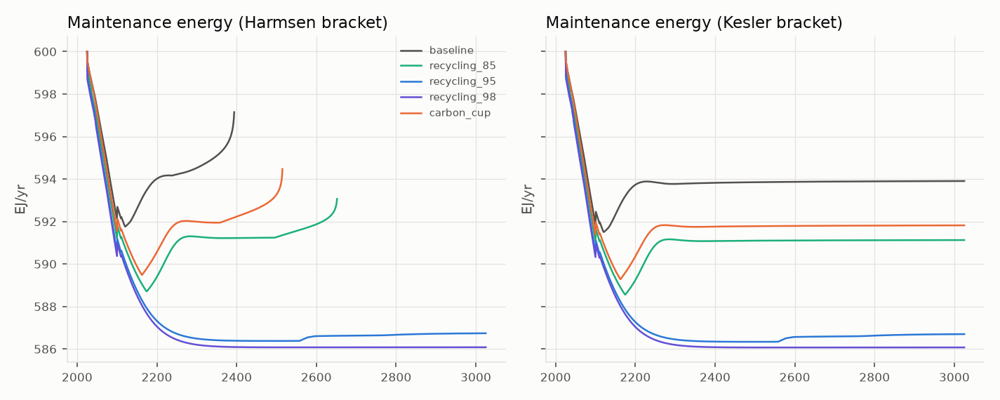
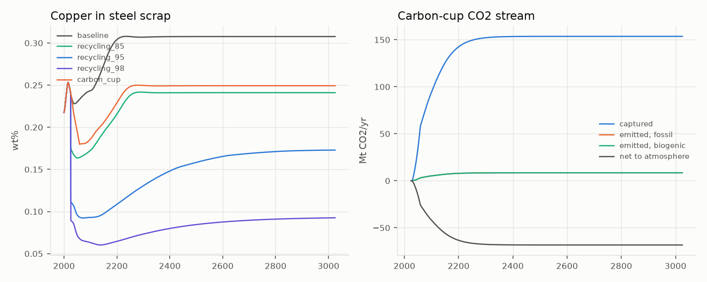
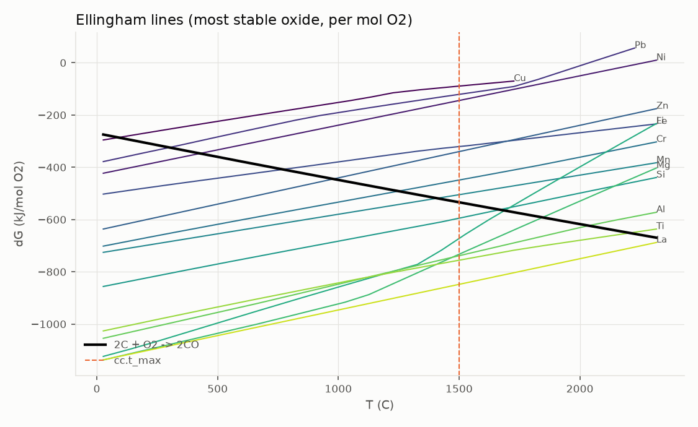

# Synthesis — ratchets, interactions and maintenance energy

*Generated by `metalwheels report synthesis` (metalwheels 0.1.0, commit `bcbc760`). Do not edit by hand; regenerate instead.*

Registry snapshot: `synthesis_snapshot.json` (registry SHA-256 `35eb5ce581a4be6c`; 232 parameters; 34 hashed input files). Every numeric table row ends with a `trace` cell: `run <id>` (run table below; outputs in `runs/<scenario>/`), `reg <key>` (parameter in the snapshot) or `file <path>` (hashed input).

## Runs

| Run ID | Scenario | Overrides | Policy | Registry | Commit |
|---|---|---|---|---|---|
| `d1bf9ffe5baf` | baseline | - | - | `35eb5ce581a4` | `bcbc760` |
| `45a873cc46f7` | recycling_85 | - | {"start_year": 2026, "ramp_years": 0, "collection": 0.85, "processing": 0.85} | `35eb5ce581a4` | `bcbc760` |
| `8de70c9b2eca` | recycling_95 | - | {"start_year": 2026, "ramp_years": 0, "collection": 0.95, "processing": 0.95} | `35eb5ce581a4` | `bcbc760` |
| `dd79298a7312` | recycling_98 | - | {"start_year": 2026, "ramp_years": 0, "collection": 0.98, "processing": 0.98} | `35eb5ce581a4` | `bcbc760` |
| `2f96b31ecc06` | carbon_cup | - | {"start_year": 2030, "ramp_years": 30, "carbon_cup": {"share": 0.5}} | `35eb5ce581a4` | `bcbc760` |

Carbon-cup sensitivity runs (scenario `carbon_cup` with overrides):

| Run ID | Scenario | Overrides | Policy | Registry | Commit |
|---|---|---|---|---|---|
| `b145d501c5ab` | cup rates at low end | {"cc.collection": 0.67, "cc.processing": 0.85} | {"start_year": 2030, "ramp_years": 30, "carbon_cup": {"share": 0.5}} | `35eb5ce581a4` | `bcbc760` |
| `9218787183ae` | matrix costs +25 MJ/kg C | {"cc.matrix_net_energy": 25.0} | {"start_year": 2030, "ramp_years": 30, "carbon_cup": {"share": 0.5}} | `35eb5ce581a4` | `bcbc760` |
| `38243c04a57b` | matrix returns 25 MJ/kg C | {"cc.matrix_net_energy": -25.0} | {"start_year": 2030, "ramp_years": 30, "carbon_cup": {"share": 0.5}} | `35eb5ce581a4` | `bcbc760` |
| `abb47f854e26` | 5 kg C/kg Cu, +25 MJ/kg C | {"cc.carbon_per_metal": 5.0, "cc.matrix_net_energy": 25.0} | {"start_year": 2030, "ramp_years": 30, "carbon_cup": {"share": 0.5}} | `35eb5ce581a4` | `bcbc760` |
| `2a23d1a527f4` | no capture, fossil carbon | {"cc.capture_fraction": 0.0, "cc.biogenic_share": 0.0} | {"start_year": 2030, "ramp_years": 30, "carbon_cup": {"share": 0.5}} | `35eb5ce581a4` | `bcbc760` |

Catalogue / Metal Wheel cross-check: all expectations met.

## 1. How many ratchets?

The catalogue holds **16** ratchets, every one sourced, across all five mechanism types: depth 1, dissipation 7, grade 1, route switch 2, tramp contamination 5. 5 are already inside the model (cu_in_steel, cu_to_other_scrap, cu_in_use_dissipation, cu_ore_grade, cu_depth); the rest are characterised (tolerance, energy step) but not yet coupled into the stock-flow or the cascade. The count is a floor, not a census: each Metal Wheel cell rated *dissolved, harmful* is a candidate tramp ratchet, and there are 13 of them [file params/metal_wheel.yaml].

| Ratchet | Mechanism | Host | Agent | Tolerance | Energy step | Per | In model | trace |
|---|---|---|---|---|---|---|---|---|
| `cu_in_steel` | tramp contamination | steel | Cu | 0.1 wt% (0.06-0.4) | 12.6 MJ/kg (8.3-14.6) | kg of iron charge switched from scrap to primary | yes | reg st.tolerance.t0100, st.tolerance.t0060, st.tolerance.t0400, st.energy.bf_bof, st.energy.scrap_eaf |
| `sn_in_steel` | tramp contamination | steel | Sn | 0.04 wt% | 12.6 MJ/kg (8.3-14.6) | kg of iron charge switched from scrap to primary | no | reg rt.steel.sn_tolerance, st.energy.bf_bof, st.energy.scrap_eaf |
| `alloys_into_carbon_steel` | dissipation | nickel, molybdenum, cobalt, tungsten | Ni | - | 111 MJ/kg (96.4-129) | kg of Ni replaced from primary | no | reg rt.ced.ni |
| `fe_in_aluminium` | tramp contamination | aluminium (wrought) | Fe | 0.35 wt% (0.35-0.7) | 160 MJ/kg (160-160) | kg of aluminium supplied from primary instead of scrap | no | reg rt.al.fe_tolerance, rt.al.energy_primary, rt.al.energy_recycling |
| `si_in_aluminium` | route switch | aluminium (wrought) | Si | 0.2 wt% (0.2-0.6) | 160 MJ/kg (160-160) | kg of wrought demand met from primary once cast demand no longer absorbs the scrap | no | reg rt.al.si_tolerance, rt.al.energy_primary, rt.al.energy_recycling |
| `al_dilution` | route switch | aluminium | alloy mix | - | 160 MJ/kg (160-160) | kg of sweetener | no | reg rt.al.energy_primary, rt.al.energy_recycling |
| `zn_to_eaf_dust` | dissipation | zinc | Zn | - | 52.9 MJ/kg (37.1-80.3) | kg of Zn not recovered from dust, replaced from primary | no | reg rt.ced.zn |
| `glass_colour_mixing` | tramp contamination | container glass (flint) | green cullet (Cr2O3, Fe2O3 colourants) | 0.5 wt% (0.5-30) | 2.06 MJ/kg (1.3-2.61) | kg of cullet that cannot be used, replaced by batch | no | reg rt.glass.green_in_flint, rt.glass.green_in_flint, rt.glass.green_in_amber, rt.glass.melt_energy, rt.glass.cullet_energy_saving |
| `polymer_blending` | tramp contamination | HDPE | PET, PA-6, PS | 5 wt% | - | No sourced virgin-vs-recycled polymer energy in the registry yet. | no | reg rt.polymer.npo_in_hdpe |
| `pt_dissipation` | dissipation | platinum-group metals | Pt | - | 243,000 MJ/kg (178,000-326,000) | kg of Pt replaced from primary | no | reg rt.ced.pt |
| `in_dissipation` | dissipation | indium | In | - | 1,720 MJ/kg (1,170-2,520) | kg of In replaced from primary | no | reg rt.ced.in |
| `ree_dissipation` | dissipation | rare earth elements | REE | - | 344 MJ/kg (267-437) | kg of Nd replaced from primary | no | reg rt.ced.nd |
| `cu_to_other_scrap` | dissipation | copper | Cu | - | 53.7 MJ/kg (42.1-68.6) | kg of Cu replaced from primary | yes | reg rt.ced.cu |
| `cu_in_use_dissipation` | dissipation | copper | Cu | - | 53.7 MJ/kg (42.1-68.6) | kg of Cu replaced from primary | yes | reg rt.ced.cu |
| `cu_ore_grade` | grade | copper | ore grade | - | - | Modelled: E(g, D) = a + b/g + k_D (D - D0) (Phase 1, Norgate/Koppelaar options). | yes | file params/ratchets.yaml (harmsen_2013) |
| `cu_depth` | depth | copper | depth | - | 0.029 MJ/kg/m (0.029-0.046) | kg Cu per additional metre of depth (MJ/kg/m) | yes | reg en.depth.energy_per_m |

Energy steps are the energy paid each time one unit goes through the ratchet: for tramp elements and route switches, primary minus secondary production energy of the host; for dissipation, the cradle-to-gate energy of replacing the lost metal from primary (Nuss and Eckelman 2014, Table S38). Ranges come from the parameters' own ranges.

## 2. How do they interact?

Declared interactions (catalogue `interactions`):

| From | Kind | To | Note | trace |
|---|---|---|---|---|
| `cu_in_steel` | amplifies | `sn_in_steel` | Tin exacerbates hot shortness (Daehn 2017), so the two tolerances are not independent. | file params/ratchets.yaml |
| `cu_in_steel` | fed_by | `cu_to_other_scrap` | Copper collected but not separated travels in steel scrap (Phase 2 link). | file params/ratchets.yaml |
| `sn_in_steel` | amplifies | `cu_in_steel` | Synergistic hot shortness. | file params/ratchets.yaml |
| `alloys_into_carbon_steel` | parallel | `cu_in_steel` | Same thermodynamics (more noble than iron), opposite sign: copper harms the host, nickel is harmless to it but lost. | file params/ratchets.yaml |
| `fe_in_aluminium` | feeds | `al_dilution` | Iron above the wrought limit is diluted with primary aluminium. | file params/ratchets.yaml |
| `si_in_aluminium` | feeds | `al_dilution` | The cast-alloy sink hides the problem only while cast demand grows. | file params/ratchets.yaml |
| `al_dilution` | parallel | `cu_in_steel` | Aluminium's analogue of the copper-in-steel dilution. | file params/ratchets.yaml |
| `zn_to_eaf_dust` | parallel | `cu_in_steel` | Same scrap stream; zinc leaves the melt, copper stays. | file params/ratchets.yaml |
| `cu_to_other_scrap` | feeds | `cu_in_steel` | This flow is the copper load of steel scrap. | file params/ratchets.yaml |
| `cu_to_other_scrap` | feeds | `cu_ore_grade` | Copper lost to steel is replaced from leaner ore. | file params/ratchets.yaml |
| `cu_in_use_dissipation` | feeds | `cu_ore_grade` | Replaced from primary. | file params/ratchets.yaml |
| `cu_ore_grade` | amplifies | `cu_depth` | Leaner ore is also deeper ore in the extraction ordering. | file params/ratchets.yaml |
| `cu_depth` | amplifies | `cu_ore_grade` | See cu_ore_grade. | file params/ratchets.yaml |

The one interaction the model can already measure end to end is copper's: copper that is collected but not separated (`cu_to_other_scrap`) becomes the copper load of steel scrap (`cu_in_steel`), and copper replaced from primary drives `cu_ore_grade` and `cu_depth`. Pulling copper out of that loop with the carbon cup moves all three at once: the steel LP crossover moves from 2121 [run d1bf9ffe5baf] to 2163 [run 2f96b31ecc06], the cumulative copper penalty in steel from 7,533 EJ to 5,463 EJ, and the Harmsen bracket's first supply shortfall from 2395 to 2516 [run 2f96b31ecc06]. A lever on one ratchet acts on its neighbours; levers should be compared on the whole chain.

The Metal Wheel makes the same point from the metallurgy side: whether an element is a ratchet depends on the carrier route it lands in. Nickel is a benign alloying element in steel but lost to the nickel cycle; gold and the PGMs are recovered in the copper route and lost (and harmful) in the steel route; zinc volatilises in the steel route and is the carrier of its own. The routes are the infrastructure, so the ratchet count depends on which infrastructures exist.

## 3. Metal Wheel compatibility matrix

48 elements x 6 carrier routes, from the UNEP (2013) Metal Wheel (Fig. 15) and element radar chart after Nakajima et al. (Fig. 64), combined by the rules in `metalwheels.ratchets.metal_wheel` [file params/metal_wheel.yaml]. Cells neither figure resolves are `unknown`, explicitly.

| Route | recovered | dissolved benign | dissolved harmful | dissolved unrated | lost to slag | volatilised | unknown | trace |
|---|---|---|---|---|---|---|---|---|
| fe | 1 | 4 | 6 | 0 | 19 | 6 | 12 | file params/metal_wheel.yaml |
| al | 1 | 8 | 6 | 15 | 7 | 3 | 8 | file params/metal_wheel.yaml |
| cu | 21 | 2 | 1 | 0 | 18 | 1 | 5 | file params/metal_wheel.yaml |
| pbzn | 15 | 0 | 0 | 2 | 7 | 1 | 23 | file params/metal_wheel.yaml |
| ni | 3 | 0 | 0 | 0 | 4 | 4 | 37 | file params/metal_wheel.yaml |
| sn | 7 | 0 | 0 | 0 | 13 | 0 | 28 | file params/metal_wheel.yaml |

Full matrix

| Element | fe | al | cu | pbzn | ni | sn |
|---|---|---|---|---|---|---|
| Fe | R | d | S | S | R | S |
| Al | S | R | S | S | S | S |
| Cu | D! | d | R | R | ? | R |
| Zn | V | V | R | R | V | R |
| Pb | V | d | R | R | V | R |
| Ni | d | d | S | d? | R | ? |
| Sn | D! | d | R | R | ? | R |
| Cr | S | D! | S | S | R | ? |
| Mn | S | d | S | S | ? | S |
| Mo | d | d? | R | ? | ? | ? |
| Co | d | d? | R | R | ? | ? |
| W | d | d? | S | d? | ? | S |
| V | S | d? | S | ? | ? | S |
| Nb | S | d? | S | ? | ? | S |
| Ta | S | d? | S | ? | ? | S |
| Ti | S | d | S | ? | ? | S |
| Zr | S | d? | S | ? | ? | S |
| Si | S | d | S | S | S | S |
| Mg | S | S | S | S | S | S |
| Ca | S | S | S | S | S | S |
| Li | ? | S | ? | ? | ? | ? |
| B | S | d? | S | ? | ? | ? |
| Ag | V | D! | R | R | ? | R |
| Au | D! | D! | R | R | ? | ? |
| Pt | D! | D! | R | R | ? | ? |
| Pd | D! | D! | R | R | ? | ? |
| Rh | D! | ? | R | ? | ? | ? |
| Ir | ? | d? | ? | ? | ? | ? |
| Bi | ? | d? | R | R | ? | R |
| Sb | ? | D! | d | R | ? | ? |
| As | ? | d? | d | ? | ? | ? |
| Se | ? | ? | R | ? | ? | ? |
| Te | ? | ? | R | ? | ? | ? |
| Cd | V | V | R | R | ? | ? |
| Hg | V | V | R | V | ? | ? |
| In | S | d? | R | R | ? | R |
| Ga | S | d? | R | R | ? | ? |
| Ge | ? | d? | R | R | ? | ? |
| REE | S | d? | S | ? | ? | S |
| Th | S | ? | D! | ? | ? | ? |
| P | ? | ? | ? | ? | ? | ? |
| F | S | ? | V | ? | V | ? |
| Cl | V | S | R | ? | V | ? |
| Br | ? | ? | R | ? | ? | ? |
| Na | ? | ? | ? | ? | ? | ? |
| K | ? | S | ? | ? | ? | ? |
| Sr | S | S | S | ? | ? | ? |
| Ba | S | S | S | ? | ? | ? |

Legend: `R` recovered, `d` dissolved benign, `D!` dissolved harmful, `d?` dissolved unrated, `S` lost to slag, `V` volatilised, `?` unknown.

Routes: `fe` Iron and steel (BOF, EAF); `al` Aluminium (remelt, refine); `cu` Copper (smelt, convert, refine); `pbzn` Lead and zinc (smelt, fume, RLE); `ni` Nickel-chromium (stainless steel); `sn` Tin (smelt, refine).

## 4. What do they do to energy demand?

Maintenance energy is the primary energy needed to deliver 2025 final demand with year-t technical coefficients (Phase 3), defined until the bracket's first copper supply shortfall.

| Scenario | Bracket | E 2025 (EJ/yr) | E 2050 (EJ/yr) | E 2100 (EJ/yr) | E 2200 (EJ/yr) | E 2500 (EJ/yr) | Defined to | rho 2100 | trace |
|---|---|---|---|---|---|---|---|---|---|
| baseline | harmsen | 600.0 | 597.4 | 592.1 | 594.0 | - | 2394 | 0.1207 | run d1bf9ffe5baf |
| baseline | kesler | 600.0 | 597.2 | 591.9 | 593.7 | 593.9 | 3025 | 0.1203 | run d1bf9ffe5baf |
| recycling_85 | harmsen | 600.0 | 596.7 | 591.2 | 589.4 | 591.3 | 2652 | 0.1190 | run 45a873cc46f7 |
| recycling_85 | kesler | 600.0 | 596.7 | 591.1 | 589.2 | 591.1 | 3025 | 0.1187 | run 45a873cc46f7 |
| recycling_95 | harmsen | 600.0 | 596.3 | 590.6 | 587.3 | 586.4 | 3025 | 0.1177 | run 8de70c9b2eca |
| recycling_95 | kesler | 600.0 | 596.3 | 590.5 | 587.3 | 586.3 | 3025 | 0.1176 | run 8de70c9b2eca |
| recycling_98 | harmsen | 600.0 | 596.2 | 590.4 | 587.1 | 586.1 | 3025 | 0.1173 | run dd79298a7312 |
| recycling_98 | kesler | 600.0 | 596.2 | 590.3 | 587.0 | 586.1 | 3025 | 0.1172 | run dd79298a7312 |
| carbon_cup | harmsen | 600.0 | 597.2 | 591.6 | 590.6 | 593.3 | 2515 | 0.1196 | run 2f96b31ecc06 |
| carbon_cup | kesler | 600.0 | 597.1 | 591.4 | 590.4 | 591.8 | 3025 | 0.1193 | run 2f96b31ecc06 |

Steel and copper ratchets by scenario:

| Scenario | Steel crossover (LP) | Crossover (aggregate) | Cum. Cu penalty in steel (EJ) | Scrap Cu 2100 (wt%) | Cu EoL recycling rate, end | Harmsen shortfall | trace |
|---|---|---|---|---|---|---|---|
| baseline | 2121 | 2130 | 7,533 | 0.243 | 0.462 | 2395 | run d1bf9ffe5baf |
| recycling_85 | 2175 | 2218 | 5,100 | 0.173 | 0.722 | 2653 | run 45a873cc46f7 |
| recycling_95 | 2558 | none | 210 | 0.093 | 0.902 | none | run 8de70c9b2eca |
| recycling_98 | none | none | 0 | 0.063 | 0.960 | none | run dd79298a7312 |
| carbon_cup | 2163 | 2198 | 5,463 | 0.186 | 0.623 | 2516 | run 2f96b31ecc06 |

**Reading.** Inside the agreed cascade boundary the modelled ratchets move maintenance energy by at most 1.4 % from its 2025 level in the Harmsen bracket [run d1bf9ffe5baf]: it is 600.0 EJ/yr in 2025 and 594.0 EJ/yr in 2200 [run d1bf9ffe5baf], with rho(A) near 0.121 [run d1bf9ffe5baf]. Two things keep the signal small, and neither means the ratchets are small: the energy sector's own use dominates rho(A) (Phase 3 sensitivity), and only copper's ratchets and copper-in-steel are coupled into A(t). The per-unit energy steps in section 1 show where the larger effects sit once coupled: aluminium route switches cost 160 MJ per kg diverted [reg rt.al.energy_primary, rt.al.energy_recycling] against 12.6 MJ/kg for steel [reg st.energy.bf_bof, st.energy.scrap_eaf], and dissipated platinum 243,000 MJ/kg [reg rt.ced.pt]. The second clear effect is timing: the ratchets decide *when* the copper and steel constraints bind (crossover and shortfall years above), which a fixed-final-demand cascade shows as a change of date more than of level.

## 5. Design lever: the carbon cup

Carbon-reducible metals housed in burnable, separable carbon sub-matrices; at end of life the product is burnt, the metal reports to the ash as oxide and carbon reduces it. Eligibility is Ellingham-based: carbon must reduce the metal's most stable oxide at or below cc.t_max = 1773 K [reg cc.t_max].

| Element | Most stable oxide | Data | Onset (K) | Eligible at 1773 K | trace |
|---|---|---|---|---|---|
| Pd | PdO | nbs ulich approx s | 298 | yes | file data/processed/oxide_thermo.csv |
| Rh | Rh2O3 | nbs ulich approx s | 298 | yes | file data/processed/oxide_thermo.csv |
| Pt | Pt3O4 | nbs ulich approx s | 298 | yes | file data/processed/oxide_thermo.csv |
| Ir | IrO2 | nbs ulich approx s | 298 | yes | file data/processed/oxide_thermo.csv |
| Ru | RuO2 | nbs ulich approx s | 298 | yes | file data/processed/oxide_thermo.csv |
| Os | OsO4 | nbs ulich | 298 | yes | file data/processed/oxide_thermo.csv |
| Au | Au(OH)3 | noble | 298 | yes | file data/processed/oxide_thermo.csv |
| Ag | Ag2O | nbs ulich | 298 | yes | file data/processed/oxide_thermo.csv |
| Hg | HgO | nbs ulich | 298 | yes | file data/processed/oxide_thermo.csv |
| Cu | Cu2O | janaf | 363 | yes | file data/processed/oxide_thermo.csv |
| Pb | PbO | janaf | 574 | yes | file data/processed/oxide_thermo.csv |
| Ni | NiO | nbs ulich | 701 | yes | file data/processed/oxide_thermo.csv |
| Co | CoO | janaf | 768 | yes | file data/processed/oxide_thermo.csv |
| Cd | CdO | nbs ulich | 780 | yes | file data/processed/oxide_thermo.csv |
| Sn | SnO | nbs ulich | 937 | yes | file data/processed/oxide_thermo.csv |
| In | In2O3 | nbs ulich | 1010 | yes | file data/processed/oxide_thermo.csv |
| Mo | MoO2 | janaf | 1014 | yes | file data/processed/oxide_thermo.csv |
| W | WO2 | janaf | 1020 | yes | file data/processed/oxide_thermo.csv |
| Fe | FeO | janaf | 1045 | yes | file data/processed/oxide_thermo.csv |
| Zn | ZnO | nbs ulich | 1253 | yes | file data/processed/oxide_thermo.csv |
| Cr | Cr2O3 | janaf | 1523 | yes | file data/processed/oxide_thermo.csv |
| Mn | MnO | nbs ulich | 1683 | yes | file data/processed/oxide_thermo.csv |
| Nb | NbO | janaf | 1747 | yes | file data/processed/oxide_thermo.csv |
| V | VO | janaf | 1887 | no | file data/processed/oxide_thermo.csv |
| B | B2O3 | janaf | 1892 | no | file data/processed/oxide_thermo.csv |
| Si | SiO2 | janaf | 1942 | no | file data/processed/oxide_thermo.csv |
| Li | Li2O | janaf | 1962 | no | file data/processed/oxide_thermo.csv |
| Mg | MgO | janaf | 2119 | no | file data/processed/oxide_thermo.csv |
| Ba | BaO | janaf | 2297 | no | file data/processed/oxide_thermo.csv |
| Sr | SrO | janaf | 2301 | no | file data/processed/oxide_thermo.csv |
| Al | Al2O3 | janaf | 2310 | no | file data/processed/oxide_thermo.csv |
| Ca | CaO | janaf | 2424 | no | file data/processed/oxide_thermo.csv |
| Zr | ZrO2 | janaf | 2449 | no | file data/processed/oxide_thermo.csv |
| Ti | TiO | janaf | 2480 | no | file data/processed/oxide_thermo.csv |
| Ce | Ce2O3 | nbs ulich | 2613 | no | file data/processed/oxide_thermo.csv |
| La | La2O3 | nbs ulich | 2642 | no | file data/processed/oxide_thermo.csv |
| Nd | Nd2O3 | nbs ulich | 2679 | no | file data/processed/oxide_thermo.csv |
| Th | ThO2 | nbs ulich | 2749 | no | file data/processed/oxide_thermo.csv |
| Y | Y2O3 | nbs ulich | 2832 | no | file data/processed/oxide_thermo.csv |

Scenario `carbon_cup` against `baseline` (Delta = cup minus baseline):

| Bracket | Year | Delta maintenance energy (EJ/yr) | Delta rho | trace |
|---|---|---|---|---|
| harmsen | 2050 | -0.199 | -0.000389 | run d1bf9ffe5baf; run 2f96b31ecc06 |
| harmsen | 2100 | -0.556 | -0.00107 | run d1bf9ffe5baf; run 2f96b31ecc06 |
| harmsen | 2200 | -3.45 | -0.00251 | run d1bf9ffe5baf; run 2f96b31ecc06 |
| harmsen | 2500 | undefined (after a shortfall) | +0.000146 | run d1bf9ffe5baf; run 2f96b31ecc06 |
| harmsen | cumulative to 2394 | -817 EJ | - | run d1bf9ffe5baf; run 2f96b31ecc06 |
| kesler | 2050 | -0.175 | -0.00035 | run d1bf9ffe5baf; run 2f96b31ecc06 |
| kesler | 2100 | -0.499 | -0.000985 | run d1bf9ffe5baf; run 2f96b31ecc06 |
| kesler | 2200 | -3.37 | -0.0024 | run d1bf9ffe5baf; run 2f96b31ecc06 |
| kesler | 2500 | -2.07 | -0.002 | run d1bf9ffe5baf; run 2f96b31ecc06 |
| kesler | cumulative to 3025 | -1,986 EJ | - | run d1bf9ffe5baf; run 2f96b31ecc06 |

CO2 stream (Mt CO2/yr; cumulative Mt CO2):

| Stream | 2050 | 2100 | 2200 | 2500 | Cumulative | trace |
|---|---|---|---|---|---|---|
| captured | 34.7 | 94.3 | 142 | 154 | 142,452 | run 2f96b31ecc06 |
| emitted, fossil | 1.93 | 5.24 | 7.92 | 8.53 | 7,914 | run 2f96b31ecc06 |
| emitted, biogenic | 1.93 | 5.24 | 7.92 | 8.53 | 7,914 | run 2f96b31ecc06 |
| net to atmosphere | -15.4 | -41.9 | -63.3 | -68.3 | -63,312 | run 2f96b31ecc06 |

Every carbon-cup parameter is an explicit assumption with a wide range [reg cc.biogenic_share, cc.capture_fraction, cc.carbon_per_metal, cc.collection, cc.matrix_net_energy, cc.processing, cc.t_max]. Sensitivity of the result to them (each row its own run, against the baseline):

| Variant | Delta E 2100, Harmsen (EJ/yr) | Delta E 2100, Kesler (EJ/yr) | Cum. Delta E, Kesler (EJ) | Cum. net CO2 (Mt) | Steel crossover (LP) | trace |
|---|---|---|---|---|---|---|
| cup rates at low end | -0.185 | -0.166 | -1,171 | -49,105 | 2150 | run d1bf9ffe5baf; run b145d501c5ab |
| matrix costs +25 MJ/kg C | -0.264 | -0.207 | -1,663 | -63,312 | 2163 | run d1bf9ffe5baf; run 9218787183ae |
| matrix returns 25 MJ/kg C | -0.847 | -0.791 | -2,310 | -63,312 | 2163 | run d1bf9ffe5baf; run 38243c04a57b |
| 5 kg C/kg Cu, +25 MJ/kg C | +0.904 | +0.961 | -368 | -278,006 | 2163 | run d1bf9ffe5baf; run abb47f854e26 |
| no capture, fossil carbon | -0.556 | -0.499 | -1,986 | +158,280 | 2163 | run d1bf9ffe5baf; run 2a23d1a527f4 |

Maintenance energy falls in 2100 (Kesler) in 4 of 5 variants. The direction holds while the matrix is cheap in energy; a carbon-heavy matrix that costs more energy to make than burning it returns can reverse it, so the net matrix energy is the parameter to pin down first. Separation and timing effects do not depend on it. For scale, the default cup (half of end-of-life copper by 2059) lifts copper's end-of-run EoL recycling rate from 0.462 [run d1bf9ffe5baf] to 0.623 [run 2f96b31ecc06], less than raising collection and processing to 0.85 for all copper (0.722 [run 45a873cc46f7]); its distinct contribution is that it targets the copper that would otherwise reach steel scrap and turns the carbon into a capturable stream.

## 6. Open items

Parameters still resting on assumptions (21): `cas.al.alumina_per_al`, `cas.al.smelting_electricity`, `cas.ammonia_per_explosive`, `cas.ce.limestone_per_clinker`, `cas.cu.secondary_energy`, `cas.cu_energy_net_of_inputs`, `cas.en.coal_per_mj`, `cas.st.rock_per_ore`, `cc.biogenic_share`, `cc.capture_fraction`, `cc.carbon_per_metal`, `cc.collection`, `cc.matrix_net_energy`, `cc.processing`, `cc.t_max`, `dem.growth_calibration_years`, `dem.population_hold_year`, `geo.discovery_smoothing_years`, `geo.max_discovery_rate`, `st.allocation_pinch`, `st.cu_to_process_losses`.

Not yet coupled into the model: the aluminium, glass, polymer and specialty-metal ratchets (characterised only); the Metal Wheel's `unknown` cells (mostly the Ni/Cr and Sn routes, which no radar sector covers); energy-sector quality (falling EROI) as a ratchet of its own.

